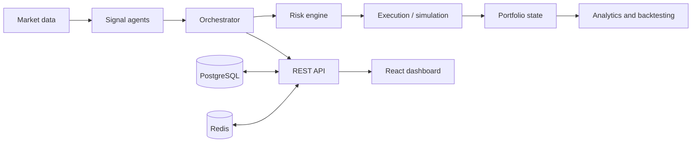

# Agentic Trading Application

A collaborative project exploring a multi-agent architecture for financial-market research, signal generation, risk checks, portfolio analytics, and historical strategy evaluation. This repository builds on concepts from the Open Finance Lab **AgenticTrading** research framework and combines backend services with a web dashboard and supporting infrastructure.

> **Research and simulation only.** This software is not investment advice. Do not connect it to a live brokerage account or use it for real-money trading without independent security, risk, and financial validation.

## Project overview

Traditional algorithmic workflows often pass data through fixed sequential stages. An agentic approach separates responsibilities into specialized agents and coordinates their outputs through an orchestration and risk layer.

### System architecture



This diagram is a conceptual overview of the repository's intended workflow, not a guarantee that every component is fully integrated or production-ready.

## Core areas

- **Agent workflows:** specialized signal, risk, portfolio, and execution responsibilities
- **Orchestration:** coordinates agent activity and validates signals
- **Risk controls:** position/exposure checks and risk-oriented safeguards
- **Market data:** market-price and historical-data integration
- **Backtesting and analytics:** strategy evaluation and measures such as Sharpe ratio, volatility, and maximum drawdown
- **API and streaming:** FastAPI-style REST endpoints and WebSocket signal streams
- **Web dashboard:** React/Vite/Tailwind frontend
- **Infrastructure:** Docker Compose, PostgreSQL, Redis, and optional Prometheus/Grafana monitoring

## Technology stack

| Layer | Technologies |
|---|---|
| Backend/API | Python, FastAPI |
| Frontend | React, Vite, Tailwind CSS |
| Data/services | PostgreSQL, Redis, SQLAlchemy |
| Streaming | WebSockets |
| Deployment | Docker, Docker Compose |
| Monitoring | Prometheus, Grafana |

Refer to the implementation and configuration files for the current state of each component.

## Run with Docker Compose

1. Clone the repository:

   ```bash
   git clone https://github.com/rohantyagi2225/Agentic-Trading-Application.git
   cd Agentic-Trading-Application
   ```

2. Create a local `.env` file based on `.env.example` and review the values. Do not commit credentials or API keys.

3. Start the services:

   ```bash
   docker compose up --build
   ```

4. When services are healthy, check the API documentation at [http://localhost:8000/docs](http://localhost:8000/docs). The Compose file also configures the frontend at port 3000 and monitoring services on their configured ports.

Startup may require local configuration or debugging depending on the environment. Review the Compose file and project documentation before exposing any service publicly.

## Example API surface

The README documents routes for:

- `GET /health` — health check
- `GET /market/price/{symbol}` — market price
- `GET /signals/{symbol}` — signal retrieval
- `GET /portfolio/metrics` — portfolio metrics
- `POST /backtest` — start a backtest
- `POST /agents/execute` — agent execution

Check the running API's OpenAPI documentation for the current route availability and request schemas.

## Evaluation and risk considerations

A credible trading evaluation should use out-of-sample or walk-forward tests, realistic transaction costs and slippage, drawdown analysis, and checks against look-ahead bias and data leakage. Do not report illustrative or historical test figures as verified live performance. A backtest is not a guarantee of future results.

## Attribution and contribution

This project is inspired by the Open Finance Lab **AgenticTrading** research framework. Review the repository's license and upstream terms when reusing or redistributing code.

**Rohan Tyagi's stated contribution:** research, documentation, system analysis, feature explanation, and workflow structuring as part of a collaborative team project.

## Limitations

- The repository contains multiple services and requires configuration; not every feature should be assumed production-ready merely because infrastructure files are present.
- Live market-data availability, API credentials, database setup, and frontend/backend integration can affect local execution.
- Security review, reproducible tests, deployment hardening, and independent financial validation are required before any real-world use.
- Use paper trading or offline simulation for experimentation; never expose credentials in source control.

## License

See the repository's `LICENSE` file and the upstream AgenticTrading project's license terms.
